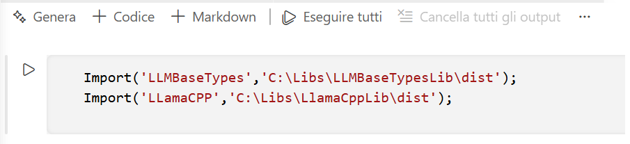

# LlamaCppLib library

[Object Pascal Notebook](https://github.com/ElCondor1969/ObjectPascalNotebook) [Llama.CPP](https://github.com/ggml-org/llama.cpp) library.

This library allows you to use the power of Llama.CPP within Object Pascal Notebook.

The library provides the following units:

- uLlamaCpp.pas

# Prepare the library

To use the library, we must first compile the Delphi **LlamaCPPLib.dproj** dynamic library project. The project uses Delphi's FMX framework to enable the library to be used on different operating systems.
The compilation will create the dynamic library in the **dist** folder, which also contains the **uLlamaCPP.pas** lib interface unit.

## Get the dependencies

For compiling the project, we need some dependencies. The below script batch allow us to get them:

```
curl -L https://raw.githubusercontent.com/ElCondor1969/ObjectPascalNotebook/main/src/OPNBHost/uLibInterface.pas -o dependencies/ObjectPascalNotebook/uLibInterface.pas

curl -L https://raw.githubusercontent.com/ElCondor1969/ObjectPascalNotebook/main/src/OPNBHost/uDynLibLoader.pas -o dependencies/ObjectPascalNotebook/uDynLibLoader.pas

curl -L https://raw.githubusercontent.com/ElCondor1969/ObjectPascalNotebook/main/src/OPNBHost/uUtility.pas -o dependencies/ObjectPascalNotebook/uUtility.pas
```

## Get the LlamaCPP libraries

The **dist** folder must contain the **llamacpp** subfolder, into which we'll place the Llama.CPP dynamic libraries compatible with our machine's operating system and hardware resources.
These libraries can be retrieved from the [Release](https://github.com/ggml-org/llama.cpp/releases) section of the Llama.CPP repository.

## Import the library into your Object Pascal Notebook

To import the library, use the following instructions:



Note that the library depends on the [LLMBaseTypesLib](https://github.com/ElCondor1969/LLMBaseTypesLib) and that this library must therefore also be present.

# `uLlamaCpp` Unit Documentation

This unit provides a Delphi wrapper for interacting with the **Llama.cpp** library. It defines configuration types, parameter classes, and the main `TLlama` class used to load models, tokenize text, and generate completions.

---

## Enumerations

### `TLlamaAttentionType`

Defines the type of attention mechanism used by the model.

| Value                              | Description                                |
| ---------------------------------- | ------------------------------------------ |
| `LLAMA_ATTENTION_TYPE_UNSPECIFIED` | Default/undefined behavior                 |
| `LLAMA_ATTENTION_TYPE_CAUSAL`      | Standard causal (autoregressive) attention |
| `LLAMA_ATTENTION_TYPE_NON_CAUSAL`  | Non-causal attention                       |

---

### `TLlamaFlashAttentionType`

Controls Flash Attention optimization.

| Value                            | Description             |
| -------------------------------- | ----------------------- |
| `LLAMA_FLASH_ATTN_TYPE_AUTO`     | Automatically decide    |
| `LLAMA_FLASH_ATTN_TYPE_DISABLED` | Disable Flash Attention |
| `LLAMA_FLASH_ATTN_TYPE_ENABLED`  | Enable Flash Attention  |

---

### `TLlamaSplitMode`

Defines how computation is split across GPUs.

| Value                    | Description                           |
| ------------------------ | ------------------------------------- |
| `LLAMA_SPLIT_MODE_NONE`  | Single GPU                            |
| `LLAMA_SPLIT_MODE_LAYER` | Split layers and KV cache across GPUs |
| `LLAMA_SPLIT_MODE_ROW`   | Split rows across GPUs                |

---

### `TLlamaRopeScalingType`

Controls RoPE (Rotary Positional Encoding) scaling strategy.

| Value                                 | Description      |
| ------------------------------------- | ---------------- |
| `LLAMA_ROPE_SCALING_TYPE_UNSPECIFIED` | Default behavior |
| `LLAMA_ROPE_SCALING_TYPE_NONE`        | No scaling       |
| `LLAMA_ROPE_SCALING_TYPE_LINEAR`      | Linear scaling   |
| `LLAMA_ROPE_SCALING_TYPE_YARN`        | YaRN scaling     |
| `LLAMA_ROPE_SCALING_TYPE_LONGROPE`    | LongRoPE scaling |

---

### `TLlamaPoolingType`

Defines pooling strategies for embeddings or classification.

| Value                     | Description               |
| ------------------------- | ------------------------- |
| `LLAMA_POOLING_TYPE_NONE` | No pooling                |
| `LLAMA_POOLING_TYPE_MEAN` | Mean pooling              |
| `LLAMA_POOLING_TYPE_CLS`  | Use CLS token             |
| `LLAMA_POOLING_TYPE_LAST` | Use last token            |
| `LLAMA_POOLING_TYPE_RANK` | Used for reranking models |

---

### `TGgmlLogLevel`

Log severity levels.

| Value                  | Description            |
| ---------------------- | ---------------------- |
| `GGML_LOG_LEVEL_NONE`  | No logging             |
| `GGML_LOG_LEVEL_DEBUG` | Debug messages         |
| `GGML_LOG_LEVEL_INFO`  | Informational messages |
| `GGML_LOG_LEVEL_WARN`  | Warnings               |
| `GGML_LOG_LEVEL_ERROR` | Errors                 |
| `GGML_LOG_LEVEL_CONT`  | Continuation           |

---

### `TGGMLNumaStrategy`

Defines NUMA memory handling strategies.

| Value                           | Description       |
| ------------------------------- | ----------------- |
| `GGML_NUMA_STRATEGY_DISABLED`   | Disabled          |
| `GGML_NUMA_STRATEGY_DISTRIBUTE` | Distribute memory |
| `GGML_NUMA_STRATEGY_ISOLATE`    | Isolate memory    |
| `GGML_NUMA_STRATEGY_NUMACTL`    | Use numactl       |
| `GGML_NUMA_STRATEGY_MIRROR`     | Mirror memory     |

---

### `TGGMLType`

Defines tensor data types and quantization formats used in GGML.

Includes:

* Floating point types (`F32`, `F16`, `BF16`, `F64`)
* Integer types (`I8`, `I16`, `I32`, `I64`)
* Quantized formats (`Q4_0`, `Q5_1`, `Q8_0`, `IQ*`, etc.)

Used for memory optimization and inference performance tuning.

---

## Classes

---

### `TLlamaModelParams`

Represents model-level configuration.

#### Constructor

```pascal
constructor Create(AJSON: JSONvariant);
```

Initializes parameters from a JSON structure.

#### Properties

| Property                  | Type              | Description                       |
| ------------------------- | ----------------- | --------------------------------- |
| `devices`                 | Integer           | Number of devices used            |
| `tensor_buft_overrides`   | Integer           | Buffer overrides                  |
| `n_gpu_layers`            | Integer           | Number of layers offloaded to GPU |
| `split_mode`              | `TLlamaSplitMode` | GPU split strategy                |
| `main_gpu`                | Integer           | Primary GPU index                 |
| `tensor_split`            | Integer           | Tensor split configuration        |
| `llama_model_kv_override` | Integer           | KV override setting               |
| `vocab_only`              | Boolean           | Load only vocabulary              |
| `use_mmap`                | Boolean           | Use memory-mapped files           |
| `use_direct_io`           | Boolean           | Use direct I/O                    |
| `use_mlock`               | Boolean           | Lock memory                       |
| `check_tensors`           | Boolean           | Validate tensors                  |
| `use_extra_bufts`         | Boolean           | Use extra buffers                 |
| `no_host`                 | Boolean           | Disable host memory               |
| `no_alloc`                | Boolean           | Disable allocations               |

---

### `TLlamaContextParams`

Defines runtime context parameters.

#### Constructor

```pascal
constructor Create(AJSON: JSONvariant);
```

#### Properties

| Property                | Type                       | Description                   |
| ----------------------- | -------------------------- | ----------------------------- |
| `n_ctx`                 | Integer                    | Context size (tokens)         |
| `n_batch`               | Integer                    | Batch size                    |
| `n_ubatch`              | Integer                    | Micro-batch size              |
| `n_seq_max`             | Integer                    | Max sequences                 |
| `n_threads`             | Integer                    | CPU threads                   |
| `n_threads_batch`       | Integer                    | Threads for batching          |
| `rope_scaling_type`     | `TLlamaRopeScalingType`    | RoPE scaling method           |
| `pooling_type`          | `TLlamaPoolingType`        | Pooling strategy              |
| `llama_attention_type`  | `TLlamaAttentionType`      | Attention type                |
| `llama_flash_attn_type` | `TLlamaFlashAttentionType` | Flash attention               |
| `rope_freq_base`        | Float                      | RoPE base frequency           |
| `rope_freq_scale`       | Float                      | RoPE scaling factor           |
| `yarn_ext_factor`       | Float                      | YaRN extension factor         |
| `yarn_attn_factor`      | Float                      | YaRN attention factor         |
| `yarn_beta_fast`        | Float                      | YaRN fast beta                |
| `yarn_beta_slow`        | Float                      | YaRN slow beta                |
| `yarn_orig_ctx`         | Integer                    | Original context size         |
| `defrag_thold`          | Float                      | Defragmentation threshold     |
| `type_k`                | Integer                    | Key tensor type               |
| `type_v`                | Integer                    | Value tensor type             |
| `embeddings`            | Boolean                    | Enable embeddings             |
| `offload_kqv`           | Boolean                    | Offload KQV to GPU            |
| `no_perf`               | Boolean                    | Disable performance tracking  |
| `op_offload`            | Boolean                    | Offload operations            |
| `swa_full`              | Boolean                    | Sliding window attention full |
| `kv_unified`            | Boolean                    | Unified KV cache              |
| `samplers`              | Integer                    | Sampler configuration         |
| `n_samplers`            | Integer                    | Number of samplers            |

---

### `TCompletationParams`

Controls text generation behavior.

#### Constructor

```pascal
constructor Create(AJSON: JSONvariant);
```

#### Properties

| Property        | Type    | Description                              |
| --------------- | ------- | ---------------------------------------- |
| `MinGenTokens`  | Integer | Minimum tokens to generate               |
| `MaxGenTokens`  | Integer | Maximum tokens to generate               |
| `Temperature`   | Float   | Sampling temperature                     |
| `TopK`          | Integer | Top-K sampling                           |
| `TopP`          | Float   | Nucleus sampling                         |
| `RepeatPenalty` | Float   | Penalty for repetition                   |
| `RepeatLastN`   | Integer | Number of tokens to consider for penalty |

---

### `TLlamaSettings`

Aggregates all configuration sections.

#### Constructor

```pascal
constructor Create(AJSON: JSONvariant);
```

#### Methods

```pascal
function ToString: string;
```

Returns a string representation of the settings.

#### Properties

| Property             | Type                  | Description           |
| -------------------- | --------------------- | --------------------- |
| `LlamaModelParams`   | `TLlamaModelParams`   | Model configuration   |
| `LlamaContextParams` | `TLlamaContextParams` | Runtime context       |
| `CompletationParams` | `TCompletationParams` | Generation parameters |

---

## Callback Types

### Logging

```pascal
TLLamaLogCallback = procedure(Sender: TObject; const LogLevel: TGgmlLogLevel; const ALog: string) of object;
TLLamaLogCallback2 = procedure(const LogLevel: TGgmlLogLevel; const ALog: string);
```

Triggered when the library emits logs.

---

### Token Streaming

```pascal
TLlamaTokenCallback = procedure(Sender: TObject; const AToken: integer; const ATextToken: string; var AContinue: boolean) of object;
TLlamaTokenCallback2 = procedure(const AToken: integer; const ATextToken: string; var AContinue: boolean);
```

Called for each generated token.
`AContinue` can be set to `False` to stop generation.

---

### Notifications

```pascal
TLlamaNotifyEvent = procedure(Sender: TObject) of object;
TLlamaNotifyEvent2 = procedure();
```

Used for signaling completion events.

---

## Main Class: `TLlama`

The primary interface for interacting with Llama.cpp.

---

### Constructor / Destructor

```pascal
constructor Create;
destructor Destroy; override;
```

* Initializes and releases internal resources.

---

### Methods

#### `LoadModel`

```pascal
procedure LoadModel(const AModel: string);
```

Loads a model from the specified file path.

---

#### `UnloadModel`

```pascal
procedure UnloadModel;
```

Releases the currently loaded model.

---

#### `Tokenize`

```pascal
function Tokenize(const Text: string; AddSpecial: Boolean = true; ParseSpecial: Boolean = true): TIntegerArray;
```

Converts text into tokens.

* `AddSpecial`: Adds special tokens (e.g., BOS/EOS)
* `ParseSpecial`: Parses special tokens in input

---

#### `Detokenize` (Single Token)

```pascal
function Detokenize(Token: integer; IncludeSpecial: Boolean = true): string;
```

Converts a single token back to text.

---

#### `Detokenize` (Multiple Tokens)

```pascal
function Detokenize(Tokens: TIntegerArray; IncludeSpecial: Boolean = true): string;
```

Converts a token array back to text.

---

#### `GetTokenEmbedding`

```pascal
function GetTokenEmbedding(Token: integer): TFloatArray;
```

Returns the embedding vector for the specified token.

To use this function, the model must be loaded with the *Embeddings* property of the *LlamaContextParams* settings property set to *true*.

---

#### `StartCompletation`

```pascal
function StartCompletation(const Prompt: string): string;
```

Generates text completion from a prompt.

Returns the generated text.

---

#### `StartChatCompletation`

```pascal
procedure StartChatCompletation(var InfoChat: TInfoChat);
```

Performs chat-style completion using structured conversation data.

---

### Properties

| Property                | Type                   | Description                  |
| ----------------------- | ---------------------- | ---------------------------- |
| `ModelPath`             | string (read-only)     | Path of the loaded model     |
| `Settings`              | `TLlamaSettings`       | Configuration settings       |
| `VocabSize`             | `Integer`              | Number of model's tokens     |
| `OnLogCallback`         | `TLLamaLogCallback`    | Log callback (object method) |
| `OnLogCallback2`        | `TLLamaLogCallback2`   | Log callback (static)        |
| `OnTokenCallback`       | `TLlamaTokenCallback`  | Token streaming callback     |
| `OnTokenCallback2`      | `TLlamaTokenCallback2` | Token streaming (static)     |
| `OnGenerationComplete`  | `TLlamaNotifyEvent`    | Completion event             |
| `OnGenerationComplete2` | `TLlamaNotifyEvent2`   | Completion event (static)    |

---

## Summary

The `uLlamaCpp` unit provides:

* Fine-grained control over model and runtime parameters
* Tokenization and detokenization utilities
* Text and chat completion capabilities
* Callback-based streaming and logging

It is designed to offer a flexible and performant Object Pascal Notebook interface to **Llama.cpp**, suitable for both simple completions and advanced conversational AI integrations.
